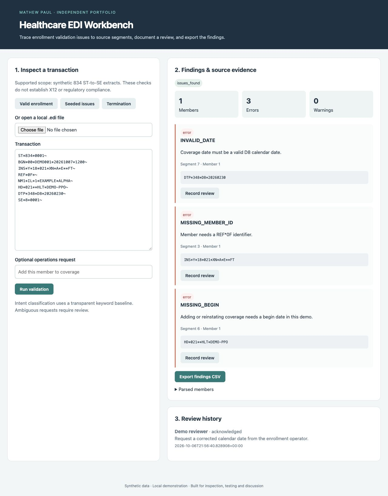

# Healthcare EDI Workbench

An enrollment operations analyst needs to locate defects in an enrollment transaction and give a reviewer enough source evidence to act.

### Working features

- Parse one synthetic 834 ST-to-SE transaction into member and coverage records.
- Check control numbers, segment counts, identifiers, supported maintenance codes and coverage dates.
- Link every finding to the relevant segment when one exists; retain unrecognized segments as warnings.
- Classify simple operations requests with a transparent keyword baseline; route ambiguous or negated requests to review.
- Persist analysis results and append-only reviewer notes; export spreadsheet-safe CSV findings.

**Stack:** Python, Flask, SQLite, pytest, accessible HTML/JavaScript UI.



## Setup

Requires Python 3.12+ (verified locally with 3.14.6). Run from this repository:

```sh
python3 -m venv .venv
source .venv/bin/activate
pip install -r requirements-dev.txt
pytest -q
python evaluate.py
python app.py
```

The app binds to localhost. `data/` is created on first run and excluded from Git. `DATABASE_PATH` can select a different SQLite file. Tests and evaluations use temporary databases. The Flask development server is intended for the local demo.

## Evidence and project status

This is a newly built independent portfolio implementation using synthetic data. It does not describe a customer deployment or measured business impact. See [evaluation results](docs/evaluation.json), [architecture](docs/architecture.md), [demo walkthrough](docs/demo.md) and [acceptance criteria](docs/acceptance.md). CI runs the Python tests and reproducible evaluation. Small, authored regression sets are useful checks, not generalization benchmarks.

Open **http://127.0.0.1:8101**.

## Demo

1. Open http://127.0.0.1:8101 and select **Seeded issues**.
2. Run validation. Expect INVALID_DATE, MISSING_MEMBER_ID and MISSING_BEGIN, each with source evidence.
3. Record a review with a rationale; rerun the same transaction and confirm the review persists.
4. Export findings CSV.
5. Load **Valid enrollment** and **Termination**; both pass the documented subset.
6. Enter “Do not terminate coverage” in the request field; the keyword classifier returns `review`.

## Limitations

See the explicit scope and deployment limitations in [architecture](docs/architecture.md).
