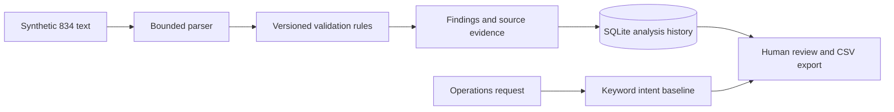

# Architecture and decisions

`edi.py` is pure domain logic. `app.py` owns persistence and HTTP. SHA-256 over ruleset plus input makes repeat analysis idempotent. Reviews append without changing the original findings. The ruleset identifier belongs to this demo, not an X12 implementation guide.

## Boundaries and tradeoffs

The accepted subset uses literal `*` element and `~` segment delimiters, one ST/SE pair, INS, REF*0F, NM1*IL, HD and DTP*348/349. BGN and N1 are preserved but not validated. This is not a general EDI parser: no ISA/GS, composite elements, dynamic delimiters, full loop hierarchy or payer-specific companion guide enforcement. Duplicate member identifiers are flagged by a demo rule; actual subscriber/dependent semantics need a companion guide. A passing result means only that these checks passed.

Request classification is deterministic, not an LLM. No model-derived explanations are implemented. The UI is local and reviewer names are self-entered; production SSO, authorization, encrypted storage and audit signing are not implemented. Use synthetic data only.

## References

The project follows the transaction's broad enrollment purpose described by [X12](https://x12.org/flow/health-care) and the coverage-date examples in [X12 Example 04](https://x12.org/examples/005010x220/example-04-add-subscriber-coverage). Fixtures are independently authored synthetic examples, not claims of conformance to the full licensed implementation guide.
